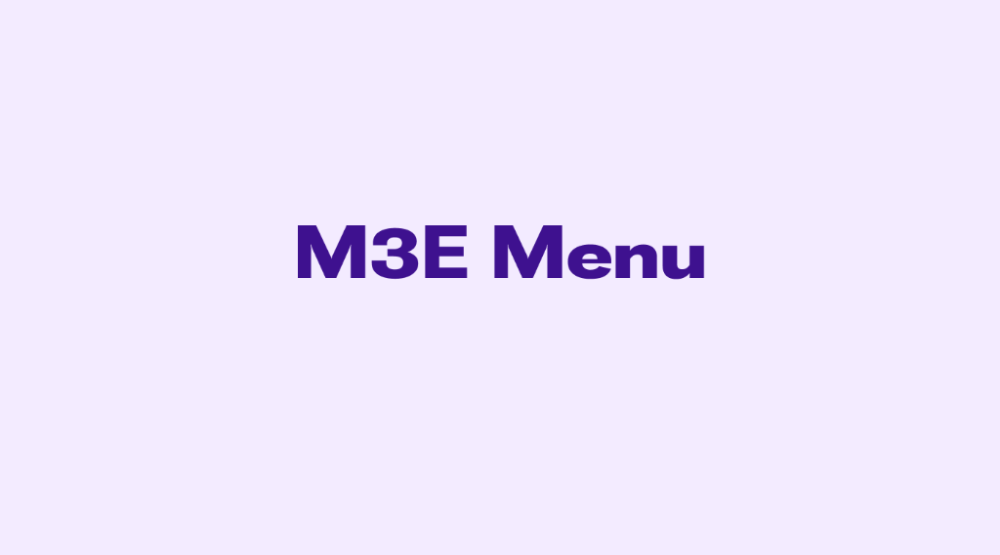

# M3E Menu



A Flutter package providing expressive, Material 3 menu components with spring physics, cascading submenus powered by the **Magic Triangle** safe navigation algorithm, segmented item groups with shape morphing, checkable/radio items, and 1:1 drop-in compatibility with Flutter's menu system.

It provides a complete suite of menu components: `M3EMenuAnchor`, `M3EMenuItemButton`, `M3ESubmenuButton`, `M3ECheckboxMenuButton`, `M3ERadioMenuButton`, `M3EMenuGroup`, `M3EMenuGroupLabel`, and `M3EPopupMenuButton`. All components feature spring-driven animations via `motor`, customizable motion presets, intelligent auto-flipping, and rich theming.

---

## 🎮 Interactive Demo

You can try out the package demo here: [m3e_core demo](https://mudit200408.github.io/m3e_core/)

---

## 🚀 Features

- **Spring-Driven Motion** — authentic Material 3 Expressive elastic pop and dropdown unroll transitions via `M3EMotion`
- **Magic Triangle Navigation** — intelligent diagonal hover tracking prevents accidental submenu closures when navigating cascading menus
- **1:1 Drop-in Replacements** — direct upgrades for `MenuAnchor`, `MenuItemButton`, `SubmenuButton`, `CheckboxMenuButton`, `RadioMenuButton`, and `PopupMenuButton`
- **Segmented Groups (`M3EMenuGroup`)** — automatic corner-radius morphing (continuous curves on outer edges, subtle radii between adjacent items)
- **Checkbox & Radio Menu Buttons** — checkable and mutually exclusive items with animated checkmarks and optimistic selection
- **Flexible Positioning (`M3EMenuPosition`)** — supports `under` (with automatic viewport-edge flip) and `over` (centered on anchor)
- **Animation Styles (`M3EMenuAnimationStyle`)** — choose between `popup` (elastic scale & fade) and `dropdown` (vertical unrolling reveal)
- **Rich Menu Items** — leading icons, trailing shortcuts (`⌘S`), badges, and secondary supporting text
- **M3 Expressive Popup Button (`M3EPopupMenuButton`)** — standalone popup menu button backed by expressive `M3EButton` triggers
- **Accessible & Keyboard-Friendly** — full Escape key dismissal, autofocus, traversal, and Semantics support

---

## 📦 Installation

> [!IMPORTANT]
> **Flutter 3.47+ & `material_ui` Requirement (v0.0.1+)**:
> Starting with `v0.0.1`, `m3e_menu` is built using the standalone `material_ui` package decoupled in **Flutter 3.47.0**.
> - Requires Flutter SDK **`>=3.47.0`**.
> - Ensure your app imports `package:material_ui/material_ui.dart` (or run `dart fix --apply --code=migrate_design_widgets`).

Add `m3e_menu`, `m3e_buttons`, and `material_ui` to your `pubspec.yaml`:

```yaml
dependencies:
  material_ui: ^1.3.0
  m3e_buttons: ^1.0.3
  m3e_menu: ^0.0.1
```

```dart
import 'package:material_ui/material_ui.dart';
import 'package:m3e_buttons/m3e_buttons.dart';
import 'package:m3e_menu/m3e_menu.dart';
```

---

## 🧩 Quick Start

### Basic Menu Anchor

```dart
final M3EMenuController _controller = M3EMenuController();

M3EMenuAnchor(
  controller: _controller,
  menuChildren: [
    M3EMenuItemButton(
      leadingIcon: const Icon(Icons.file_open_outlined),
      trailingIcon: const Text('⌘O', style: TextStyle(fontSize: 12, color: Colors.grey)),
      onPressed: () => print('Open File'),
      child: const Text('Open File...'),
    ),
    M3EMenuItemButton(
      leadingIcon: const Icon(Icons.save_outlined),
      trailingIcon: const Text('⌘S', style: TextStyle(fontSize: 12, color: Colors.grey)),
      onPressed: () => print('Save File'),
      child: const Text('Save'),
    ),
  ],
  builder: (context, controller, child) {
    return M3EButton(
      onPressed: () => controller.isOpen ? controller.close() : controller.open(),
      child: const Text('File Actions'),
    );
  },
)
```

### Cascading Submenus with Magic Triangle

```dart
M3EMenuAnchor(
  menuChildren: [
    M3EMenuItemButton(
      leadingIcon: const Icon(Icons.copy_rounded),
      onPressed: () {},
      child: const Text('Copy'),
    ),
    M3ESubmenuButton(
      leadingIcon: const Icon(Icons.ios_share_rounded),
      menuChildren: [
        M3EMenuItemButton(
          leadingIcon: const Icon(Icons.picture_as_pdf_outlined),
          onPressed: () {},
          child: const Text('Export as PDF'),
        ),
        M3EMenuItemButton(
          leadingIcon: const Icon(Icons.image_outlined),
          onPressed: () {},
          child: const Text('Export as PNG'),
        ),
      ],
      child: const Text('Export As'),
    ),
  ],
  builder: (context, controller, child) {
    return M3EButton(
      onPressed: () => controller.open(),
      child: const Text('Options'),
    );
  },
)
```

### Segmented Groups with Checkbox and Radio Items

```dart
bool _autoSave = true;
String _density = 'Comfortable';

M3EMenuAnchor(
  menuChildren: [
    const M3EMenuGroupLabel(child: Text('Editor Settings')),
    M3EMenuGroup(
      children: [
        M3ECheckboxMenuButton(
          value: _autoSave,
          leadingIcon: const Icon(Icons.sync_rounded),
          onChanged: (val) => setState(() => _autoSave = val ?? false),
          child: const Text('Auto-save changes'),
        ),
      ],
    ),
    const M3EMenuGroupLabel(child: Text('Density')),
    M3EMenuGroup(
      children: [
        M3ERadioMenuButton<String>(
          value: 'Compact',
          groupValue: _density,
          onChanged: (val) => setState(() => _density = val!),
          child: const Text('Compact'),
        ),
        M3ERadioMenuButton<String>(
          value: 'Comfortable',
          groupValue: _density,
          onChanged: (val) => setState(() => _density = val!),
          child: const Text('Comfortable'),
        ),
      ],
    ),
  ],
  builder: (context, controller, child) => M3EButton(
    onPressed: () => controller.open(),
    child: const Text('Preferences'),
  ),
)
```

### Expressive Popup Menu Button

```dart
M3EPopupMenuButton<String>(
  icon: const Icon(Icons.more_vert_rounded),
  onSelected: (action) => print('Selected: $action'),
  itemBuilder: (context) => [
    const M3EPopupMenuItem(
      value: 'profile',
      child: Text('View Profile'),
    ),
    const M3EPopupMenuItem(
      value: 'settings',
      child: Text('Settings'),
    ),
    const M3EPopupMenuDivider(),
    const M3EPopupMenuItem(
      value: 'logout',
      child: Text('Log out', style: TextStyle(color: Colors.red)),
    ),
  ],
)
```

---

## 📖 Detailed API Guide

### 1. `M3EMotion`

Spring physics configuration with 12 built-in presets and custom spring creation via `motor`.

#### 🏗️ Spatial Presets (Shape & Position)
Used for animating menu surface scaling and shape morphing.

| Preset | Stiffness | Damping | Description |
|--------|-----------|---------|-------------|
| `standardSpatialFast` | `1400` | `0.9` | Snappy spring for responsive feel |
| `standardSpatialDefault` | `700` | `0.9` | Balanced spring for general use |
| `standardSpatialSlow` | `300` | `0.9` | Relaxed spring for dramatic feel |
| `expressiveSpatialFast` | `800` | `0.6` | Bouncier spring for expressive feel (Default) |
| `expressiveSpatialDefault` | `380` | `0.8` | Bouncy, balanced spring |
| `expressiveSpatialSlow` | `200` | `0.8` | Very bouncy for dramatic feel |

#### ✨ Effects Presets (Opacity / Fades)
Used for content fade-in and barrier transitions.

| Preset | Stiffness | Damping | Description |
|--------|-----------|---------|-------------|
| `standardEffectsFast` | `3800` | `1.0` | Snappy effect animation |
| `standardEffectsDefault` | `1600` | `1.0` | Balanced effect animation |
| `standardEffectsSlow` | `800` | `1.0` | Relaxed effect animation |
| `expressiveEffectsFast` | `3800` | `1.0` | Snappy expressive effect (Default) |
| `expressiveEffectsDefault` | `1600` | `1.0` | Balanced expressive effect |
| `expressiveEffectsSlow` | `800` | `1.0` | Relaxed expressive effect |

#### 🛠️ Custom Motion

```dart
M3EMotion.custom(stiffness: 1000, damping: 0.7)
```

---

### 2. `M3EMenuAnchor` & `M3EMenuController`

The root anchor widget hosting popup overlays and coordinating submenu cascades.

#### `M3EMenuAnchor` Parameters

| Parameter | Type | Default | Description |
|-----------|------|---------|-------------|
| `controller` | `M3EMenuController?` | — | Controller to open/close/query the menu |
| `menuChildren` | `List<Widget>` | `required` | Children widgets displayed inside the menu popup |
| `builder` | `M3EMenuAnchorChildBuilder?` | — | Builds the trigger widget bound to the controller |
| `style` | `M3EMenuStyle?` | — | Custom visual styling and spring configuration |
| `colorSchemeVariant` | `dynamic` | `null` | Optional variant token for AOSP dynamic color mapping (`M3EMenuColorSchemeVariant`) |
| `alignmentOffset` | `Offset` | `Offset.zero` | Offset applied to the resolved position |
| `clipBehavior` | `Clip` | `Clip.hardEdge` | Clipping behavior for the menu surface |
| `requestFocus` | `bool` | `true` | Whether the menu requests focus upon opening |
| `child` | `Widget?` | — | Child widget if not using `builder` |

#### `M3EMenuController` Methods & Properties

| Member | Return Type | Description |
|--------|-------------|-------------|
| `open({Offset? position})` | `void` | Opens the menu popup, optionally relative to a custom coordinate |
| `close()` | `void` | Closes this menu popup |
| `closeAll()` | `void` | Closes this menu and all ancestor/descendant menus in the active tree |
| `isOpen` | `bool` | Returns `true` if this menu popup is currently open and visible |

---

### 3. `M3EMenuItemButton`

An expressive interactive button designed for menu items with Material 3 typography and alignment.

| Parameter | Type | Default | Description |
|-----------|------|---------|-------------|
| `onPressed` | `VoidCallback?` | — | Callback invoked when the button is tapped (`null` disables item) |
| `child` | `Widget?` | — | Primary label of the menu item |
| `leadingIcon` | `Widget?` | — | Icon displayed before the label (start) |
| `trailingIcon` | `Widget?` | — | Icon or shortcut widget displayed after the label (end) |
| `supportingText` | `Widget?` | — | Secondary subtitle text below the primary label |
| `closeOnActivate` | `bool` | `true` | Whether tapping the item closes the active menu tree |
| `itemStyle` | `M3EMenuItemStyle?` | — | Per-item style override (colors, padding, shapes) |
| `enabled` | `bool` | `true` | Whether the item is interactive |
| `focusNode` | `FocusNode?` | — | Focus node for keyboard navigation |
| `autofocus` | `bool` | `false` | Whether item acquires focus initially |

```dart
M3EMenuItemButton(
  leadingIcon: const Icon(Icons.content_cut_rounded, size: 20),
  trailingIcon: const Text('⌘X', style: TextStyle(color: Colors.grey)),
  supportingText: const Text('Move to clipboard'),
  onPressed: () => handleCut(),
  child: const Text('Cut'),
)
```

---

### 4. `M3ESubmenuButton` & `M3EMagicTriangle`

Cascading submenus with safe diagonal pointer traversal.

#### `M3ESubmenuButton` Parameters

| Parameter | Type | Default | Description |
|-----------|------|---------|-------------|
| `menuChildren` | `List<Widget>` | `required` | Items displayed inside the cascading submenu |
| `child` | `Widget?` | — | Label of the submenu item |
| `leadingIcon` | `Widget?` | — | Icon displayed before the label |
| `trailingIcon` | `Widget?` | `Icon(Icons.arrow_right)` | Indicator icon showing submenu cascade |
| `itemStyle` | `M3EMenuItemStyle?` | — | Style overrides for the trigger button |
| `menuStyle` | `M3EMenuStyle?` | — | Style overrides for the child submenu surface |
| `controller` | `M3EMenuController?` | — | Optional controller for programmatic control |
| `enabled` | `bool` | `true` | Whether the submenu can be opened |

#### `M3EMagicTriangle` Geometry API
`M3EMagicTriangle` creates a dynamic safe transit zone between the trigger cursor and the submenu boundaries so diagonal mouse movements do not accidentally close submenus:

| Static Method | Returns | Description |
|---------------|---------|-------------|
| `containsPoint(Offset p, Offset a, Offset b, Offset c)` | `bool` | Evaluates whether point `p` lies inside the triangle formed by vertices `a`, `b`, and `c` |
| `isCursorInSubmenuTransitZone(...)` | `bool` | Computes whether the cursor at `cursorPosition` is in the safe transit cone toward `submenuBounds` |

---

### 5. `M3ECheckboxMenuButton` & `M3ERadioMenuButton`

Stateful toggle buttons for menu preferences.

#### `M3ECheckboxMenuButton` (Multi-Select)

| Parameter | Type | Default | Description |
|-----------|------|---------|-------------|
| `value` | `bool` | `required` | Checked state of the checkbox |
| `onChanged` | `ValueChanged<bool?>?` | `required` | Called when value toggles |
| `child` | `Widget?` | — | Primary label |
| `leadingIcon` | `Widget?` | — | Optional custom icon before the checkbox |
| `trailingIcon` | `Widget?` | — | Optional custom icon after the label |
| `supportingText` | `Widget?` | — | Secondary subtitle text below label |
| `closeOnActivate` | `bool` | `false` | Whether to dismiss the menu on toggle |
| `itemStyle` | `M3EMenuItemStyle?` | — | Styling overrides |
| `enabled` | `bool` | `true` | Whether item is interactive |

#### `M3ERadioMenuButton<T>` (Single-Select)

| Parameter | Type | Default | Description |
|-----------|------|---------|-------------|
| `value` | `T` | `required` | Value represented by this radio option |
| `groupValue` | `T?` | `required` | Currently selected value of the group |
| `onChanged` | `ValueChanged<T?>?` | `required` | Called when selected |
| `child` | `Widget?` | — | Primary label |
| `leadingIcon` | `Widget?` | — | Optional custom icon before the radio |
| `trailingIcon` | `Widget?` | — | Optional custom icon after the label |
| `supportingText` | `Widget?` | — | Secondary subtitle text below label |
| `closeOnActivate` | `bool` | `true` | Whether to dismiss the menu on selection |
| `itemStyle` | `M3EMenuItemStyle?` | — | Styling overrides |
| `enabled` | `bool` | `true` | Whether item is interactive |

---

### 6. `M3EMenuGroup` & `M3EMenuGroupLabel`

Groups menu items visually and coordinates shape morphing across adjacent items.

#### `M3EMenuGroup` Parameters

| Parameter | Type | Default | Description |
|-----------|------|---------|-------------|
| `children` | `List<Widget>` | `required` | Items within this visual segment |
| `shapes` | `MenuGroupShapes?` | `null` | Custom corner morphing shapes for the group |
| `spatialMotion` | `M3EMotion` | `standardSpatialDefault` | Motion spring for corner radius animations |

#### `M3EMenuGroupLabel` Parameters

| Parameter | Type | Default | Description |
|-----------|------|---------|-------------|
| `child` | `Widget` | `required` | Label widget (usually `Text`) displayed in header style |
| `padding` | `EdgeInsetsGeometry` | `start: 12, end: 12` | Padding around the label |

---

### 7. `M3EPopupMenuButton<T>` & `M3EPopupMenuEntry<T>`

Expressive drop-in replacement for Flutter's `PopupMenuButton<T>`, powered by an underlying `M3EMenuAnchor` and styled `M3EButton` triggers. All entries inherit from `M3EPopupMenuEntry<T>`.

#### `M3EPopupMenuButton<T>` Parameters

| Parameter | Type | Default | Description |
|-----------|------|---------|-------------|
| `itemBuilder` | `M3EPopupMenuItemBuilder<T>` | `required` | Builds the list of popup items |
| `initialValue` | `T?` | — | Highlights matching entry |
| `onSelected` | `M3EPopupMenuItemSelected<T>?` | — | Called when an item is selected |
| `onCanceled` | `M3EPopupMenuCanceled?` | — | Called when the popup is dismissed without selection |
| `tooltip` | `String?` | — | Tooltip for the trigger button |
| `icon` | `Widget?` | `Icon(Icons.more_vert)` | Trigger icon widget |
| `iconSize` | `double?` | — | Custom size for the trigger icon |
| `iconColor` | `Color?` | — | Custom color for the trigger icon |
| `triggerStyle` | `M3EButtonStyle` | `M3EButtonStyle.tonal` | Style for trigger (`filled`, `tonal`, `outlined`, `elevated`, `text`) |
| `triggerDecoration` | `M3EButtonDecoration?` | — | Visual decoration override for trigger button |
| `style` | `M3EMenuStyle?` | — | Styling for the menu overlay surface |
| `offset` | `Offset` | `Offset.zero` | Alignment offset relative to trigger |
| `colorSchemeVariant` | `dynamic` | `null` | Optional variant token (`standard` or `vibrant`) |
| `enabled` | `bool` | `true` | Whether the trigger is interactive |

To open the menu programmatically via a `GlobalKey<M3EPopupMenuButtonState<T>>`:
```dart
popupKey.currentState?.showButtonMenu();
```

#### Popup Menu Entries

- **`M3EPopupMenuItem<T>`**: Standard selectable entry
  | Property | Type | Default | Description |
  |----------|------|---------|-------------|
  | `value` | `T?` | — | Value returned to `onSelected` |
  | `onTap` | `VoidCallback?` | — | Callback executed before menu closes |
  | `enabled` | `bool` | `true` | Whether item can be selected |
  | `height` | `double?` | `48.0` | Minimum height of item |
  | `padding` | `EdgeInsetsGeometry?` | — | Content padding |
  | `child` | `Widget?` | — | Item content |

- **`M3ECheckedPopupMenuItem<T>`**: Checkable entry displaying an animated checkmark
  | Property | Type | Default | Description |
  |----------|------|---------|-------------|
  | `value` | `T?` | — | Value returned to `onSelected` |
  | `checked` | `bool` | `false` | Whether checkmark is displayed |
  | `onTap` | `VoidCallback?` | — | Tap callback |
  | `enabled` | `bool` | `true` | Interactive state |
  | `child` | `Widget?` | — | Item content |

- **`M3EPopupMenuDivider`**: Horizontal divider line between sections
  | Property | Type | Default | Description |
  |----------|------|---------|-------------|
  | `height` | `double` | `16.0` | Total vertical space allocated to divider |

---

### 8. `M3EMenuStyle`, `M3EMenuItemStyle` & Shapes

Complete control over visual styling, color palettes, and corner shapes.

#### `M3EMenuStyle` Properties

| Property | Type | Default | Description |
|----------|------|---------|-------------|
| `backgroundColor` | `Color?` | Theme surface | Background fill color |
| `surfaceTintColor` | `Color?` | Theme tint | Material surface tint color |
| `shadowColor` | `Color?` | Black with alpha | Drop shadow color |
| `elevation` | `double?` | `3.0` | Container elevation |
| `padding` | `EdgeInsetsGeometry?` | `8.0 vertical` | Internal padding |
| `shape` | `ShapeBorder?` | `RoundedRectangleBorder(16.0)` | Surface shape |
| `minWidth` | `double?` | `112.0` | Minimum menu width |
| `maxWidth` | `double?` | `280.0` | Maximum menu width |
| `position` | `M3EMenuPosition` | `under` | Position relative to anchor (`under` or `over`) |
| `animationStyle` | `M3EMenuAnimationStyle` | `popup` | Animation type (`popup` or `dropdown`) |
| `spatialMotion` | `M3EMotion` | `expressiveSpatialFast` | Spring physics for scale/position |
| `effectsMotion` | `M3EMotion` | `expressiveEffectsFast` | Spring physics for opacity |

#### `M3EMenuColorSchemeVariant`
- `M3EMenuColorSchemeVariant.standard`: Surface-based color palette for general context menus.
- `M3EMenuColorSchemeVariant.vibrant`: Tertiary-based color palette providing bold emphasis for prominent actions.

#### `M3EMenuItemStyle` Properties

| Property | Type | Description |
|----------|------|-------------|
| `backgroundColor` | `Color?` | Item container background color when unselected |
| `foregroundColor` | `Color?` | Text and icon foreground color when unselected |
| `selectedBackgroundColor` | `Color?` | Background color when selected or checked |
| `selectedForegroundColor` | `Color?` | Foreground color when selected or checked |
| `leadingIconColor` | `Color?` | Leading icon color override |
| `trailingIconColor` | `Color?` | Trailing icon/shortcut color override |
| `disabledForegroundColor` | `Color?` | Color when item is disabled |
| `textStyle` | `TextStyle?` | Primary label text style |
| `selectedTextStyle` | `TextStyle?` | Primary label style when selected |
| `supportingTextStyle` | `TextStyle?` | Secondary subtitle text style |
| `trailingTextStyle` | `TextStyle?` | Shortcut badge text style |
| `padding` | `EdgeInsetsGeometry?` | Inner padding applied to item |
| `shapes` | `MenuItemShapes?` | Corner shapes for unselected and selected states |
| `spatialMotion` | `M3EMotion` | Spring motion for interactive shape morphing |

#### `MenuItemShapes` & `MenuGroupShapes` Factories
Control the morphing corners of items inside groups:
- `MenuItemShapes.standalone()`: 4dp radius unselected, 12dp radius selected.
- `MenuItemShapes.leading()`: Rounded top corners.
- `MenuItemShapes.trailing()`: Rounded bottom corners.
- `MenuItemShapes.middle()`: Square/subtle corners between neighboring items.
- `MenuItemShapes.resolve(index, count)`: Automatically resolves the appropriate shape by index.
- `MenuGroupShapes.standalone()` / `MenuGroupShapes.resolve(index, count)`: Resolves outer group boundaries.

---

### 9. `M3EMenuTokens`

Material 3 Expressive design tokens defining layout dimensions, paddings, and timings.

| Token | Value | Description |
|-------|-------|-------------|
| `containerMinWidth` | `112.0` | Minimum container width |
| `containerMaxWidth` | `280.0` | Maximum container width |
| `containerCornerRadius` | `16.0` | Default surface corner radius |
| `itemCornerRadius` | `12.0` | Default item button corner radius |
| `itemHeight` | `48.0` | Standard menu item height |
| `denseItemHeight` | `36.0` | Dense/compact menu item height |
| `elevation` | `3.0` | Default popup elevation |
| `closedScaleTarget` | `0.8` | Starting scale factor during open animation |
| `expandedScaleTarget` | `1.0` | Final scale factor when fully open |
| `groupLabelMinHeight` | `24.0` | Minimum height for section group labels |
| `groupLabelPaddingStart` | `12.0` | Horizontal start padding for group labels |
| `groupLabelPaddingEnd` | `12.0` | Horizontal end padding for group labels |

---

### 10. Accessibility & Keyboard Navigation

- **Escape Key**: Automatically dismisses the topmost open menu.
- **Tab & Arrow Traversal**: Keyboard focus is maintained across menu items and nested cascading submenus.
- **Directionality**: Fully supports Right-to-Left (RTL) text directions with automatic flip of leading/trailing icons and cascading submenu directions.
- **Semantics**: Checkbox and radio buttons announce their selection state and mutual exclusivity to screen readers.

---

## 🐞 Found a bug? or ✨ You have a Feature Request?

Feel free to open an [Issue](https://github.com/Mudit200408/m3e_core/issues) or [Contribute](https://github.com/Mudit200408/m3e_core/pulls) to the project.

Hope You Love It!

---

## Credits

- [Motor](https://pub.dev/packages/motor) Pub Package for Expressive Animations
- Claude and Gemini for helping with the code and documentation.

### Radhe Radhe 🙏
